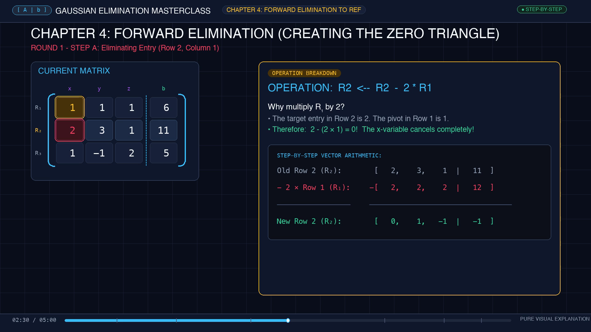
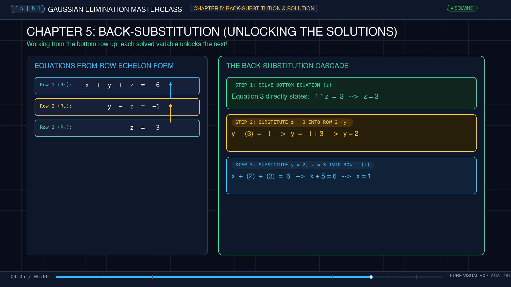
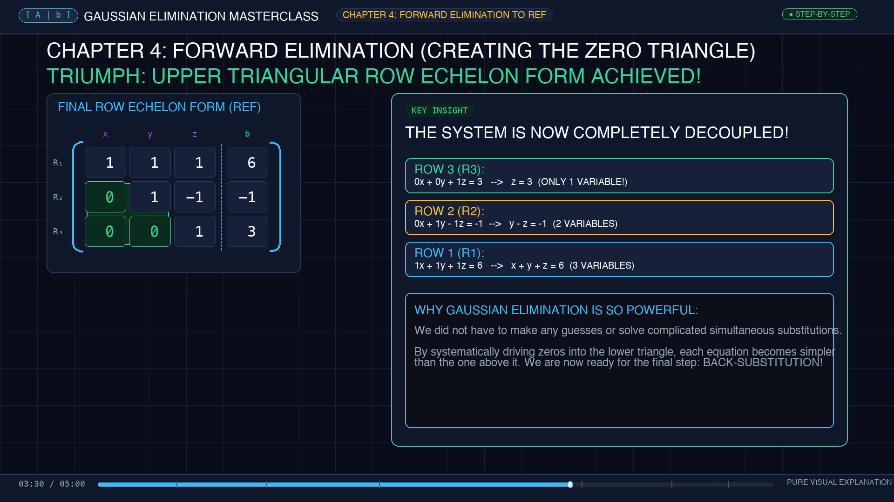
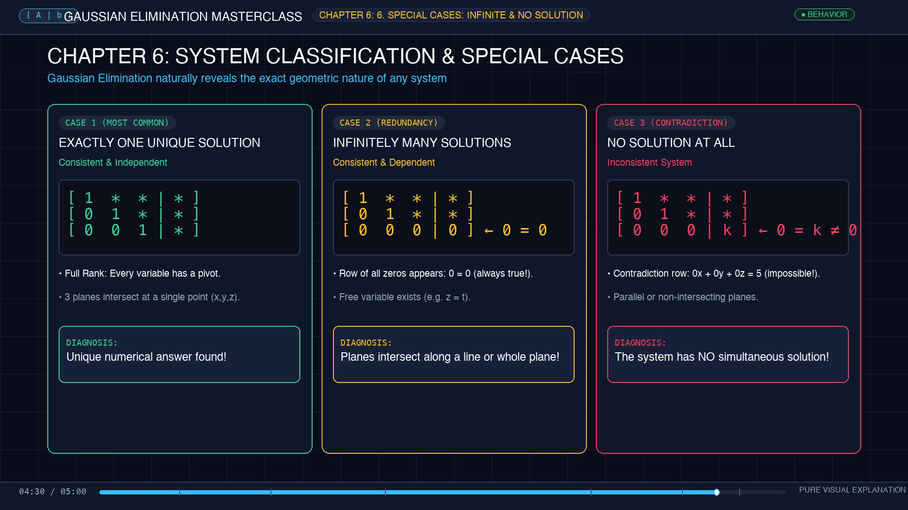

# Gaussian Elimination - Animated Mathematical Explanation

A 5-minute animated video explaining the concept of **Gaussian Elimination** from start to finish using pure visual motion graphics, animated matrices, and step-by-step arithmetic breakdowns.

No voiceover needed — everything is explained through animated transformations, glowing pivots, and vector subtraction panels.

---

## Video Preview Screenshots

| Forward Elimination to REF | Back-Substitution Cascade |
| :---: | :---: |
|  |  |

| Row Echelon Form (Zero Triangle) | System Classification |
| :---: | :---: |
|  |  |

---

## Video Specifications

- **File:** `gaussian_elimination_full_concept.mp4`
- **Duration:** 5 minutes (300 seconds / 7,200 frames)
- **Resolution:** 1920x1080 (1080p Full HD)
- **Frame Rate:** 24 FPS
- **Audio:** Silent (pure visual learning)

---

## Topics Covered

1. **Foundations & Core Problem:** Why manual substitution fails for larger systems and the motivation for systematic matrix reduction.
2. **Augmented Matrix Formulation:** Stripping variables $x, y, z$ to form $[A \mid b]$.
3. **The 3 Elementary Row Operations (EROs):**
   - Row Swap ($R_i \leftrightarrow R_j$)
   - Row Scaling ($R_i \leftarrow k \cdot R_i$)
   - Row Addition/Subtraction ($R_i \leftarrow R_i + k \cdot R_j$)
4. **Step-by-Step Forward Elimination:**
   - Concrete $3 \times 3$ system solved line-by-line.
   - Creating the lower-left "Zero Triangle" to achieve Row Echelon Form (REF).
5. **Back-Substitution Cascade:**
   - Solving from bottom row up ($z = 3$, $y = 2$, $x = 1$).
   - Solution vector verification against all original equations.
6. **System Behavior & Classification:**
   - Unique solution (consistent & independent).
   - Infinitely many solutions (row of zeros $0 = 0$).
   - No solution / Inconsistent (contradiction row $0 = k \neq 0$).
7. **Gauss-Jordan vs. Gaussian:**
   - Computational complexity ($O(\frac{2}{3}n^3)$ vs. $O(n^3)$).
   - Real-world applications: 3D graphics, GPS trilateration, circuit analysis, and machine learning.

---

## How to Run & Generate the Video

### Prerequisites

- Python 3.10+
- FFmpeg installed and available in your PATH

### Installation

```bash
pip install -r requirements.txt
```

### Render Video

```bash
python generate_gaussian_video.py
```

The script will render the frames and stream them directly into FFmpeg to generate `gaussian_elimination_full_concept.mp4`.

---

## License

MIT
